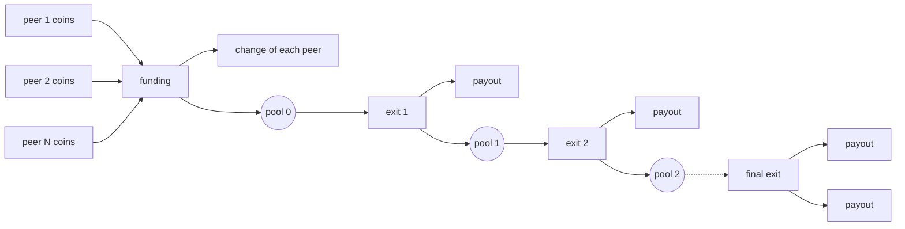
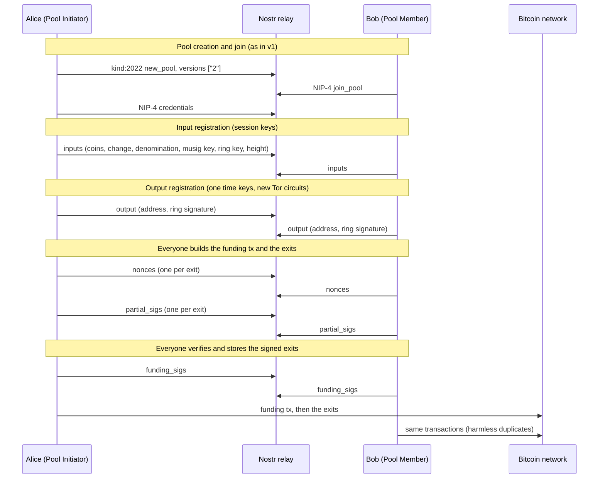
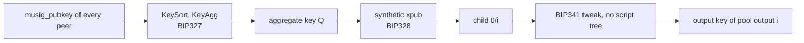

# NIP

## Joinstr v2 with MuSig2 and pre-signed transactions

This NIP describes version 2 of joinstr. Peers find each other and talk over nostr as in [version 1](https://gitlab.com/invincible-privacy/joinstr/-/blob/main/NIP.md), but the coinjoin is no longer a single transaction with equal outputs.

The peers fund one taproot output that only all of them together can spend, using a MuSig2 aggregate key. Before anyone signs the funding transaction, all peers sign the transactions that pay every peer out of that output. They form a chain by default, an exit for every order in which peers can leave in small pools, or a tree. Each transaction in the chain spends one input with a single key path signature and creates a few outputs, so on chain it looks like an ordinary payment with change from a single key taproot wallet.

The transactions have the same shape as the ones in the [OP_CTV payment pool PoC](https://github.com/stutxo/op_ctv_payment_pool). The difference is that the CTV templates are replaced by transactions signed in advance, which works on bitcoin today and spends every pool output through the key path instead of a CTV script.

This document is the specification. [docs/design.md](docs/design.md) explains the same design step by step, and [docs/signet-demo.md](docs/signet-demo.md) shows runs on signet.

### Motivation

A version 1 coinjoin has N inputs and N outputs of the same amount in one transaction. This pattern is easy to detect, and chain analysis companies and some exchanges flag coins that pass through it.

Version 2 keeps the equal amounts, which are the source of privacy in a coinjoin, but spreads them over transactions that look like normal payments. The anonymity set is the same as in version 1 (the number of peers with the same denomination), while no single transaction has the shape of a coinjoin.

## Overview



| Transaction | Inputs | Outputs | Looks like |
|---|---|---|---|
| Funding | coins of all N peers (P2WPKH or P2TR) | pool output 0 (P2TR) and the change of each peer that needs one | a wallet spending several coins to one address, with change |
| Exit k, before the last | pool output k-1, key path | one or more payouts and pool output k (P2TR) | a taproot wallet paying one or more addresses, with change |
| Final exit | the last pool output, key path | the remaining payouts | a taproot wallet paying the last addresses |

By default every exit pays one peer and the final exit pays two. A pool can also let several peers leave in the same exit ([exit plan](#amounts)), make earlier exits pay higher fees, mix several denominations, and add an anchor output to every exit for fee bumping. Instead of a chain, a pool of up to 7 peers can pre-sign an exit for every order in which its peers may leave, and a larger pool can arrange its exits as a binary tree ([Structures](#structures)).

Every pool output is a P2TR output whose internal key is derived from the MuSig2 aggregate key of all peers, with no script tree ([BIP86](https://github.com/bitcoin/bips/blob/master/bip-0086.mediawiki) style). It is spent with one 64 byte signature, like any single key taproot output. Every payout is a P2TR output.

The protocol runs in these steps.

1. **Create a pool.** Alice publishes a `kind:2022` event, as in version 1, with `"versions": ["2"]`.

2. **Join.** Bob sends `join_pool` to the pool key and receives the pool credentials, as in version 1.

3. **Register inputs.** Every peer publishes its coins, its change, its denomination, a MuSig2 key and a ring key from a new session key.

4. **Register outputs.** Every peer publishes its payout address from a one time key, with a ring signature that proves it is one of the registered peers of that denomination without saying which one.

5. **Sign the exits.** Every peer builds the funding transaction and the exits from the input registrations, then the peers run MuSig2 for all exits at once, one round of nonces and one round of partial signatures.

6. **Sign the funding.** Every peer checks the fully signed exit chain, stores it, and only then signs its own coins in the funding transaction.

7. **Broadcast.** Any peer broadcasts the funding transaction followed by the exits, or the peers keep the exits and each one [leaves](#leaving) when it wants.



## Details

### Pool

```json
{
  "versions": ["2"],
  "id": "<unique id>",
  "network": "<regtest/signet/testnet/mainnet>",
  "type": "new_pool",
  "public_key": "<new pubkey>",
  "denomination": <payout amount in sats, integer>,
  "peers": <number of peers, 2 to 100>,
  "denominations": [{ "amount": <sats>, "peers": <count> }, ...],
  "timeout": <unix timestamp for expiry>,
  "relays": ["<relay url>"],
  "fee_rate": <sat/vB of the funding transaction>,
  "exits": [<payouts in exit 1>, <payouts in exit 2>, ...],
  "exit_fee_rates": [<sat/vB of the first exit>, <sat/vB of the last exit>],
  "fee_split": "equal" | "by_exit",
  "anchor": "p2a",
  "structure": "chain" | "any_order" | "tree",
  "broadcast": "now" | "staggered" | "hold",
  "transport": {
    "vpn": {
      "enable": <boolean>,
      "vpn_gateway": <riseup vpn gateway>
    },
    "tor": {
      "enable": <boolean>
    }
  }
}
```

Changes from version 1.

- `versions` contains `"2"`. Version 1 clients ignore the pool.
- `denomination` is an integer number of sats. With `"fee_split": "equal"` it is the exact value of every payout and each peer pays the fees on top of it (see [Amounts](#amounts)).
- `peers` is at most 100. MuSig2 traffic grows with the square of the pool size, since every peer sends one nonce and one partial signature per exit.
- `fee_rate` is the fee rate of the funding transaction, and of every exit unless `exit_fee_rates` is given. Rates may have up to three decimals.

New optional fields.

- `denominations` lets several denominations share one pool. Each entry gives an amount and how many peers use it. The amounts must be different, every entry needs at least 2 peers (a denomination of one peer links its payout to its coins), and the counts add up to `peers`. `denomination` is then the first amount. Without this field the pool has one denomination, `denomination`, for all `peers`.
- `exits` is the exit plan, how many payouts each exit pays, in chain order. Each entry is 1 to 250 and they add up to `peers`. The default is one payout per exit and two in the final exit.
- `exit_fee_rates` gives the fee rate of the first and of the last exit, with the exits in between on a straight line. The default is `fee_rate` for every exit.
- `fee_split` says who pays the exits. `"equal"` (default) shares all exit fees between the peers, so every payout is exactly its denomination. `"by_exit"` makes the payouts of each exit pay for that exit, so with decreasing `exit_fee_rates` the peers who leave first pay more.
- `anchor` set to `"p2a"` adds a pay to anchor output to every exit, so that anyone can bump it later (see [Broadcast](#broadcast)).
- `structure` says how the exits leave the pool (see [Structures](#structures)). `"chain"`, the default, signs one chain in payout order. `"any_order"` signs an exit for every peer from every state the pool can reach, so the peers can leave in any order. It needs 3 to 7 peers and the default exit plan. `"tree"` signs a binary tree, so a peer leaves through at most `ceil(log2 N)` exits. It needs the default exit plan and `"fee_split": "equal"`.
- `broadcast` defaults to `"now"` (see [Broadcast](#broadcast)).

The optional `autct` field and the join flow (`join_pool`, `credentials`, `reject`) are unchanged, except that messages carry `"version": "2"`.

### Channel

After joining, every peer holds the pool private key. All further messages are NIP-4 events (`kind:4`) that are encrypted to the pool public key and tagged with it (`["p", <pool pubkey>]`), so every peer can read all of them with the pool key and the relay can read none of them.

Unlike version 1, messages are not authored by the pool key.

- `inputs`, `nonces`, `partial_sigs`, `funding_sigs` and `abort` are authored by the peer's **session key**, a new nostr key for each peer and pool. MuSig2 needs to know which nonce and which partial signature came from which signer, and the nostr signature of the event provides that. These messages are tied to the peer's coins anyway, so the session key reveals nothing new.
- `output` is authored by a **one time key** that is never used again. It is sent over a new Tor circuit, after a random delay, so that the relay cannot connect it to a session key by connection or timing.

A session key MUST NOT publish two different messages of the same type, or for `nonces` and `partial_sigs`, of the same type and `offset`. If a peer sees that, it aborts the pool.

Every peer holds the pool key, so any peer can encrypt a message that decrypts as if another key had sent it. Only the event signature shows who sent a message. A peer MUST check the id and signature of every event it reads, and ignores events it has already seen. Relays check signatures too, but the pool creator chooses the relay.

### Input registration

```json
{
  "version": "2",
  "type": "inputs",
  "musig_pubkey": "<33 byte compressed public key, hex>",
  "ring_pubkey": "<33 byte compressed public key, hex>",
  "denomination": <sats>,
  "inputs": [
    {
      "txid": "<txid>",
      "vout": <output index>,
      "amount": <sats>,
      "script_pubkey": "<hex>",
      "proof": { "sig": "<hex>", "pubkey": "<hex, P2WPKH only>" }
    }
  ],
  "change": { "address": "<address>", "amount": <sats> },
  "height": <block height of the peer's chain tip>
}
```

- `musig_pubkey` and `ring_pubkey` are new keys used only in this pool.
- `denomination` is the denomination the peer joins. It may be left out when the pool has only one.
- Every input MUST be a confirmed and unspent P2WPKH or P2TR output. Inputs that need a script sig (legacy or P2SH) are not allowed, because signing them changes the txid of the funding transaction (see [Security](#security)).
- `proof` shows that the peer can spend the input, so that nobody can block a pool with coins of other people. The message is `m = H("joinstr/v2/ownership", id || session_pubkey || txid || vout)`, where `session_pubkey` is the 32 byte nostr key that authors the event, `txid` is in the byte order of an outpoint and `vout` is 4 bytes little endian. For P2TR the proof is a BIP340 signature of `m` by the output key of the input (the key in the script). For P2WPKH it is a DER encoded ECDSA signature of `m` and the public key whose HASH160 is the witness program.
- `change` is `null` when the peer has no change, which MUST be the case when the change would be below the dust limit of its script.
- The contribution of the peer, `sum(inputs.amount) - change.amount`, MUST cover `denomination + exit_share + funding_fee` of that peer (see [Amounts](#amounts)).
- `height` is the peer's current chain tip.

Input registration is complete when there are `peers` input registrations from different session keys, each denomination has exactly its number of peers, and all `musig_pubkey`, all `ring_pubkey`, all inputs and all change addresses are different. If more than `peers` input registrations appear, the pool aborts.

A peer checks every input registration against its own view of the chain. Each input must exist, be unspent and confirmed, have the registered amount and script, be P2WPKH or P2TR, and have a valid proof.

### Output registration

When input registration is complete, each peer waits a random delay, opens a new connection over a new Tor circuit, and publishes its payout address from a one time key.

```json
{
  "version": "2",
  "type": "output",
  "address": "<P2TR address>",
  "denomination": <sats>,
  "priority": <0 to 255>,
  "ring_sig": {
    "key_image": "<33 bytes, hex>",
    "c0": "<32 bytes, hex>",
    "s": ["<32 bytes, hex>", ...]
  }
}
```

- `address` MUST be a P2TR address that is new and used for nothing else. The exits then only have P2TR outputs, so the payments and the change cannot be told apart by script type.
- `denomination` is the denomination of the payout. It may be left out when the pool has only one.
- `priority` is optional and defaults to 0. Payouts with a higher priority leave earlier (see [Transactions](#transactions)). Nobody can tell whose payout asked for it.
- `ring_sig` is a linkable ring signature (see [Ring signature](#ring-signature)) of `m = H("joinstr/v2/payout", id || priority || denomination || script_pubkey)`, with `priority` as 1 byte and `denomination` as 8 bytes little endian, over the ring of the `ring_pubkey` of every peer registered with that denomination. It proves that the output comes from one of those peers without saying which one, and its key image is the same whichever output the peer signs, so each peer can register only one output. Because `priority` and `denomination` are signed, nobody can change them.

An output is valid if its ring signature verifies for the ring of its denomination and its key image and address have not been seen before in this pool. Output registration is complete when there are `peers` valid outputs. Each peer MUST find its own address exactly once.

This replaces the recovery flow of version 1 (phase 3 and 4). Outputs that do not come from registered peers cannot be added, so a pool cannot be blocked by registering extra outputs.

### Amounts

Let `N` be the number of peers, `m` the number of exits and `g_k` the number of payouts of exit k (from the exit plan). Fees are computed from weight units (WU) as `fee(w, r) = ceil(w * r / 4)`, using integer math on rates times 1000. `A` is 240 sats if the pool has anchors and 0 otherwise.

**Exit costs**, which do not depend on the amounts.

- Exit k has one key path input (230 WU), `g_k` P2TR payouts, one P2TR pool output unless it is the final exit, and the anchor if any. Its weight is `w_k = 42 + 230 + 172 * outputs + (52 if anchor)`, so 616 WU (154 vB) for one payout and the pool output.
- Its fee rate is `r_k = (first * (m - k) + last * (k - 1)) / (m - 1)`, rounded down, where `first` and `last` are the two `exit_fee_rates`. With one exit it is `first`.
- Its base fee is `F_k = fee(w_k, r_k)`.

**Shares.**

- With `"equal"`, every peer pays `exit_share = ceil(sum(F_k + A) / N)` and every payout is exactly its denomination.
- With `"by_exit"`, `exit_share` is 0 and every payout of exit k is its denomination minus `ceil((F_k + A) / g_k)`.

**Pool values.** `pool_0 = sum over all peers of (denomination + exit_share)`. For k from 1 to m-1, `pool_k = pool_(k-1) - (payouts of exit k) - A - F_k`. The final exit pays its payouts and the anchor, and its fee is what is left, which is at least `F_m` and includes all rounding.

**Funding fee.** Each peer pays for the weight it adds to the funding transaction plus its part of the shared weight.

- each input weighs 272 WU for P2WPKH and 230 WU for P2TR (key path)
- a change output weighs `4 * (9 + len(script_pubkey))`, so 124 WU for P2WPKH and 172 WU for P2TR
- the shared part is 42 WU for version, locktime, counts and segwit marker, plus 172 WU for the pool output, so each peer pays for `ceil(214 / N)`
- `funding_fee = fee(inputs + change + ceil(214 / N), fee_rate)`

The sum of all funding fees is at least the fee rate times the size of the funding transaction (with fewer than 253 inputs and outputs). A peer may contribute more than it needs, and the excess goes to the miners. Every payout must be at least 330 sats.

These are the amounts of a chain. The other structures reuse the exit costs, see [Structures](#structures).

Example with `N = 5`, one denomination `d = 10000` and `fee_rate = 2`. Each exit pays 308 sats, `exit_share` is 247, and the pool outputs are 51235, 40927, 30619 and 20311 sats. The final exit pays 10000 twice and 311 sats of fee. A peer with one P2TR coin and P2TR change contributes `10000 + 247 + 223 = 10470` sats.

### Transactions

All peers build the same unsigned transactions from the input registrations. Hashes are BIP340 tagged hashes, `H(tag, x) = SHA256(SHA256(tag) || SHA256(tag) || x)`, and `id` is the pool id as UTF-8 bytes.

Every transaction of the pool has

- version 2,
- `nLockTime = h`, where `h` is the smallest `height` in the input registrations, like the anti fee sniping locktime of Bitcoin Core and other wallets. A peer aborts if `h` is more than 100 blocks below its own tip.
- `nSequence = 0xfffffffd` on every input, which signals RBF like Bitcoin Core and Electrum do by default.

**Funding.** The inputs are all registered inputs, ordered by `H("joinstr/v2/input_order", id || outpoint)`. The outputs are pool output 0 with value `pool_0` and every change output, ordered by `H("joinstr/v2/output_order", id || txout)`, where `outpoint` and `txout` are serialized as in transactions. Both orders look random, like the shuffled inputs and change position of Bitcoin Core.

**Payout order.** Payouts are ordered by `priority`, highest first, then by `H("joinstr/v2/payout_order", id || script_pubkey)`. Exit 1 pays the first `g_1` payouts, exit 2 the next `g_2`, and so on.

**Exits.** Every exit has one input that spends a pool output, and `k` is its position in signing order, from 1 (see [Structures](#structures)). In a chain, exit k spends pool output k-1 (the pool output of the funding transaction for k = 1, of exit k-1 otherwise). The outputs of an exit are its payouts, the pool outputs it creates, and the anchor (`OP_1 OP_PUSHBYTES_2 4e73`, 240 sats) if the pool has anchors, ordered by `H("joinstr/v2/exit_output_order", id || k || txout)` with `k` as 4 bytes little endian. In a chain every exit but the final one creates pool output k.

### Structures

Every pool output has an index `i`. Pool output 0 is the one of the funding transaction, and the key of pool output `i` is the child `0/i` (see [Keys](#keys)). Every exit spends one pool output. The exits are listed, built and signed in the order below, and `k` is the position of an exit in that list, from 1.

**Chain** (`"chain"`). Exit k spends pool output k-1 and, unless it is the final exit, creates pool output k. Its amounts are in [Amounts](#amounts).

**Every order** (`"any_order"`). A state is the list of payout positions (in payout order, from 0) that have left the pool, in the order they left. The states are listed breadth first. The first is the empty state. Each following level holds, for every state of the level before in order, that state extended by each position that is not in it, from the lowest. The last level has `N-2` positions. State `i` in this list is pool output `i`.

For every state in order, with `j` payouts gone,

- if three or more payouts are left, there is one exit for each payout `q` left, from the lowest position. It pays `q` and creates the pool output of the state extended by `q`.
- if two are left, there is one final exit that pays both.

An exit from a state with `j` payouts gone costs what exit `j+1` of a chain with the default exit plan costs, its weight, rate and base fee `F_(j+1)`, so every path pays the fees of the chain. With `"equal"`, `exit_share` and `pool_0` are those of the chain and every payout is its denomination. With `"by_exit"`, the payout of a single exit is its denomination minus `F_(j+1) + A`, and each payout of a final exit is its denomination minus `ceil((F_(N-1) + A) / 2)`. The pool output an exit creates is the one it spends minus the payout, `A` and `F_(j+1)`. The fee of a final exit is what is left.

Signatures commit to the transaction an exit spends, so the same payouts gone in two different orders are two states with exits of their own. A pool of N peers signs

`sum over j from 0 to N-3 of N! / (N-j-1)!` single exits and `N! / 2` final exits.

| Peers | Exits signed | Exits used when everyone leaves |
|---|---|---|
| 3 | 6 | 2 |
| 4 | 28 | 3 |
| 5 | 145 | 4 |
| 6 | 876 | 5 |
| 7 | 6139 | 6 |

**Tree** (`"tree"`). The payout positions are split into a binary tree. A node covers a range of positions, the root all N. A node of `n` positions gives the first `ceil(n / 2)` to its first child and the rest to its second. A child of one position is that payout, a child of more positions is a new node. The nodes are numbered breadth first from the root, which is 0, and node `i` is the exit that spends pool output `i` and creates the pool outputs of its children that are nodes. A tree has `N-1` exits, every exit has two outputs besides the anchor, and a payout is at most `ceil(log2 N)` exits away from the funding transaction.

Every node weighs `42 + 230 + 2 * 172 (+ 52 with an anchor)` WU. With `D` the depth of the deepest node, the rate of a node at depth `d` is `(first * (D - d) + last * d) / D` rounded down, or `first` if `D` is 0, and its base fee is `F_i = fee(weight, rate)`. Every peer pays `exit_share = ceil(sum(F_i + A) / N)`. The pool output of node `i` is `F_i + A` plus its payouts and the pool outputs of its children, except pool output 0, which is `pool_0` as in [Amounts](#amounts), so the root's fee includes the rounding.

### Keys

1. Sort the N `musig_pubkey` with `KeySort` and aggregate them with `KeyAgg` from [BIP327](https://github.com/bitcoin/bips/blob/master/bip-0327.mediawiki). This is the aggregate key `Q`.
2. Turn `Q` into a synthetic xpub as in [BIP328](https://github.com/bitcoin/bips/blob/master/bip-0328.mediawiki).
3. The internal key of pool output `i` is the child `0/i` of that xpub (unhardened).
4. The output key is the internal key tweaked as in [BIP341](https://github.com/bitcoin/bips/blob/master/bip-0341.mediawiki) with no script tree, as in BIP86.



In descriptor form ([BIP390](https://github.com/bitcoin/bips/blob/master/bip-0390.mediawiki)) the pool outputs are `tr(musig(K1,...,KN)/0/*)` at their indexes. Each output has a different key and nobody outside the pool can tell that they are related.

To sign for pool output `i`, the session context of BIP327 has the sorted keys and three tweaks in this order, the BIP32 tweaks of steps `0` and `i` as plain tweaks (as BIP328 describes) and the BIP341 tweak as an x-only tweak.

Every peer signs every exit, including the exits after the one that pays it. If the key of a later pool output only included the peers who had not left yet, the set of signers would shrink by exactly the peers paid at each step, which would connect each `musig_pubkey`, and so each input registration and its coins, to its payout.

### Signing the exits

The message of exit k is its BIP341 signature hash for input 0, key path, `SIGHASH_DEFAULT`, no annex. Every peer computes it from the transactions it built and never signs a message it did not compute.

**Nonces.**

```json
{
  "version": "2",
  "type": "nonces",
  "offset": <position of the first nonce, 0 if absent>,
  "nonces": ["<66 bytes, hex>", ...]
}
```

One public nonce per exit, the one at position k-1 for exit k. A pool with many exits does not fit in one event, so a peer MAY split its nonces into several messages of consecutive nonces, each starting at position `offset`. A peer SHOULD put at most 200 nonces or 400 partial signatures in one message, about 27 kB of JSON, since relays limit the size of events. A peer puts the messages of each session key together and aborts on parts that overlap or on more nonces than exits. Each is made with `NonceGen` from BIP327 with the peer's secret key, its public key, the output key of the pool output that exit k spends, the message of exit k and `extra_in = id || k`, with `k` as 4 bytes little endian. Secret nonces are kept only in memory and are never used twice. A new attempt after an abort uses new nonces.

**Partial signatures.**

```json
{
  "version": "2",
  "type": "partial_sigs",
  "offset": <position of the first signature, 0 if absent>,
  "sigs": ["<32 bytes, hex>", ...]
}
```

A peer signs only after it has nonces from all N session keys. For exit k it sums the N nonces at position k-1 with `NonceAgg` and signs with `Sign`, then deletes the secret nonce.

When all partial signatures are in, each peer checks each of them with `PartialSigVerify`, which shows who sent a bad one, combines them with `PartialSigAgg` and verifies the result as a BIP340 signature for the output key of the spent pool output. The witness of exit k is that 64 byte signature.

A client that signs with an external signer can carry the exits as PSBTs with the MuSig2 fields of [BIP373](https://github.com/bitcoin/bips/blob/master/bip-0373.mediawiki). The messages above stay the same. The proof of concept saves every signed exit as a PSBT with `PSBT_IN_TAP_KEY_SIG`, the internal key, its derivation `0/i` from the aggregate key (the fingerprint is the one of the BIP328 synthetic xpub) and `PSBT_IN_MUSIG2_PARTICIPANT_PUBKEYS`, and the same fields for the pool outputs it creates. Bitcoin Core 31 decodes them and finalizes them into the signed exits.

### Signing the funding

Before signing any of its inputs, a peer MUST check all of the following with its own view of the chain.

1. Every input of the funding transaction exists, is unspent, is P2WPKH or P2TR, has an empty script sig, and has the registered amount and script.
2. Its own inputs and its change are in the funding transaction exactly as registered.
3. The pool output is the P2TR output of pool index 0 for the aggregate of all N `musig_pubkey`, its own key included, with value `pool_0`.
4. Every contribution covers the share of that peer, so the funding transaction pays at least `fee_rate`.
5. Every exit spends the pool output its place in the [structure](#structures) says, every output and value follows [Amounts](#amounts), [Transactions](#transactions) and [Structures](#structures), and the final exits have no pool output.
6. Its own payout address is paid exactly once.
7. Every exit has a valid signature.
8. It has written the unsigned funding transaction and all signed exits to disk.

Then it signs its inputs with `SIGHASH_DEFAULT` (P2TR) or `SIGHASH_ALL` (P2WPKH), never with `ANYONECANPAY`, `NONE` or `SINGLE`, and publishes the witnesses.

```json
{
  "version": "2",
  "type": "funding_sigs",
  "witnesses": [
    { "txid": "<txid>", "vout": <output index>, "witness": ["<hex>", ...] }
  ]
}
```

Each peer checks the witnesses of the other peers before broadcasting.

**Why not `SIGHASH_ALL|ANYONECANPAY` as in version 1.** The flag is harmless in version 1 and dangerous here, because of the pre-signed exits.

- In version 1, adding an input to a coinjoin with the `ANYONECANPAY` signatures still pays every output exactly, since `ALL` covers the outputs. The extra input becomes extra fee, every output still belongs to its owner, and nothing depends on the txid.
- In version 2, the funding transaction pays into one output that needs every peer's signature, and the only way out is the exits, which spend it by its outpoint `funding_txid:vout`. With `ANYONECANPAY` any peer could take the signatures from the channel, add one input of its own and broadcast. The coins would land in the pool output under a new txid, and none of the signed exits could spend them. Releasing them would need new exits signed by every peer, so one peer could hold everyone's coins for ransom.

`ANYONECANPAY` is also visible on chain (a trailing `0x81` on P2WPKH signatures, 65 byte P2TR signatures), while ordinary wallets use `SIGHASH_ALL` or `SIGHASH_DEFAULT`. The proof of coin ownership that the `ANYONECANPAY` signature provided in version 1 is the `proof` field of the input registration in version 2. A covenant such as CTV, where the exits do not depend on the txid of the funding transaction, would make `ANYONECANPAY` safe again, but it needs a soft fork.

### Broadcast

When all witnesses are in, any peer can finalize the funding transaction. Every peer keeps all transactions and can broadcast them, so a peer that disappears cannot stop the others.

- `"now"` broadcasts the funding transaction and then the exits right away, in waves. Mempool policy limits chains of unconfirmed transactions (25 in Bitcoin Core's ancestor and descendant limits), so a peer broadcasts at most 20 transactions of the pool before earlier ones confirm, and at most 10 when it adds bumping children. A small pool enters the mempool at once and usually confirms in one block. A pool of 100 peers takes about five blocks.
- `"staggered"` broadcasts exit k only after exit k-1 (or the funding transaction) has a confirmation. The exits then land in different blocks, like payments made over time.
- `"hold"` broadcasts the funding transaction only. Every peer keeps the exits and [leaves](#leaving) when it wants.

With `"now"` and `"staggered"`, a tree broadcasts every node in order, and a pool with every order broadcasts one path, the one where the payouts leave in payout order.

Broadcasting a transaction that is already known is harmless. The owner of payout k can always push the exits up to its own.

**Fee bumping.** The exits cannot be replaced because they are signed by all peers.

- Without anchors, the owner of a payout spends it with a higher fee (CPFP), which pays for all of its unconfirmed ancestors. The payouts of the final exit can bump the whole chain.
- With anchors, anyone can bump an exit with a child that spends its anchor output (the anchor input has an empty witness) and one of its own coins, without touching any payout. The exit and the child SHOULD be submitted together as a package (`submitpackage` in Bitcoin Core, `POST /api/txs/package` on mempool.space), which also works when the exit alone pays less than the mempool minimum fee. Anchor outputs are rare on chain, so they make the exits recognizable. A pool trades that for fee control.

The funding transaction can also be bumped through a change output.

Version 3 (TRUC) transactions with zero value anchors would avoid the 240 sat anchor, but TRUC allows only one unconfirmed child per transaction, so a chain of exits could only advance one exit per block.

### Leaving

A peer leaves by broadcasting the exits between the current state of the pool and its payout.

1. Start at pool output 0.
2. While the pool output is spent, find the saved exit that spent it, which is on chain or in the mempool. If that exit pays the peer, it is done. Otherwise go on with the pool output it created that leads to the peer's payout.
3. At the first pool output that is not spent, take the exit from there that pays the peer if there is one, otherwise the exit whose pool output leads to the payout, and go on from that pool output until an exit pays the peer.
4. Broadcast the exits taken, in order.

In a chain this is every exit up to the peer's own. With every order it is one exit, or the final exit when two peers are left. In a tree it is the rest of the peer's branch, which may pay one or two other peers on the way. A peer that leaves pays for its exits only if the signed fee rates are too low and it bumps them.

Every peer holds every exit, so any peer can broadcast any of them, also the ones that pay others. Nobody can stop or change a peer's exit once the funding transaction is signed, but one peer can push others out earlier than they want. [docs/design.md](docs/design.md#what-one-peer-can-do) explains what that means for large pools.

### Failure handling

Each step has a deadline (10 minutes is a reasonable default). If a step does not complete, or a check fails, the peer stops and MAY publish

```json
{
  "version": "2",
  "type": "abort",
  "reason": "<text>"
}
```

- Before a peer publishes `funding_sigs`, aborting costs nothing. Its coins were never signed away. It deletes its secret nonces.
- After it published `funding_sigs`, the funding transaction can still be completed by whoever holds back the last signature. The peer keeps the signed exits and watches its inputs. If the funding transaction confirms, it broadcasts the exits and gets its payout. To cancel, it spends one of its inputs to itself, and once that confirms it can delete the pool data.

Relays drop connections and subscriptions now and then, more so when many peers join at once. A peer SHOULD reconnect, subscribe again and publish again any event the relay has not acknowledged. Reading the stored events a second time is harmless, since peers ignore events they have seen.

Most failures point to a session key, and so to coins. A session key that does not send a message, sends an invalid proof, nonce or partial signature, or registers a coin that fails the checks identifies coins that clients SHOULD refuse in later pools. A missing output is the exception, because outputs are anonymous by design, so a pool that never gets all its outputs aborts without blaming anyone.

### Ring signature

The ring signature is LSAG (Liu, Wei and Wong 2004) on secp256k1 with compressed 33 byte points.

- The ring `P_0, ..., P_(n-1)` is the set of all `ring_pubkey` of one denomination, sorted by their bytes, and `ring_hash = SHA256(P_0 || ... || P_(n-1))`.
- `Hp(P)` hashes a point to a point. For `i = 0, 1, 2, ...` let `t = H("joinstr/v2/hash_to_point", P || i)` with `i` as 4 bytes little endian. The first `t` that is the x coordinate of a curve point gives that point with even y.
- `Hc(I, m, L, R) = int(H("joinstr/v2/ring", ring_hash || I || m || L || R)) mod n`.

To sign `m` with the secret key `x` of `P_j`, compute the key image `I = x * Hp(P_j)`, pick a random `a`, let `c_(j+1) = Hc(I, m, a*G, a*Hp(P_j))`, and for each `i` from `j+1` around the ring to `j-1` pick a random `s_i` and compute `c_(i+1) = Hc(I, m, s_i*G + c_i*P_i, s_i*Hp(P_i) + c_i*I)`. Finally `s_j = a - c_j * x mod n`. The signature is `I`, `c0` and `s_0, ..., s_(n-1)`.

To verify, start from `c0`, compute `c_(i+1)` for `i` from 0 to n-1 with the formula above, and accept if `c_n = c0`. Every `s_i` and `c0` must be below the group order, `I` must be a valid point, and no intermediate point may be infinity.

### Privacy

**On chain.** The funding transaction looks like a wallet spending several coins to one taproot address with change, or like a consolidation if no peer needs change. The common input ownership heuristic assigns all of its inputs to one owner, which is wrong. Each exit is indistinguishable from a single key taproot payment, with the version, locktime, sequence and output order that common wallets use, and payments and change of the same type. The payouts of a denomination all have the same value (or depend only on the exit with `"by_exit"`), and the funding transaction merges every contribution into one output, so an observer cannot tell which payout belongs to which coin. The anonymity set of a payout is the number of peers of its denomination, as in version 1.

What remains visible to someone who looks for this exact pattern is a funding transaction followed by a chain of payments, with pool outputs that shrink at each step. It reveals the set of payouts, which version 1 reveals too. Contributions (input minus change) are equal for all peers of a denomination up to their own fees, which hints that the funding transaction has several owners. Peers can hide that by using coins that need no change. The `"staggered"` broadcast spreads the exits over several blocks. Anchor outputs are recognizable, so pools that care most about looking normal should not use them.

Several denominations in one pool make the chain look more like ordinary spending, with payments of different amounts, without mixing their anonymity sets. `"by_exit"` makes payouts less round, since each one carries its exit's fee.

**Between peers.** Peers see all inputs and all payouts. The payout of a peer cannot be connected to its input registration, because the ring signature hides which registered peer of that denomination signed it, the one time key and Tor circuit hide the connection, and the random delay hides the timing. A peer's denomination is visible in its input registration and its payout, which is the price of several denominations sharing a pool. Nonces and partial signatures are tied to session keys, which are tied to inputs, but they reveal nothing about payouts.

**Network.** As in version 1, peers connect over Tor, or all through the same VPN gateway. Each peer keeps its connections on its own Tor circuit, apart from the output registration, which always uses a new circuit so the relay cannot link a payout to a session by connection.

### Security

**No theft.** A pool output can only be spent with a partial signature from every peer. An honest peer only signs the exit messages it computed itself, and the exits pay every registered payout. So the only way the coins leave the pool is through the signed exits (or a new transaction that every peer signs). A peer signs its funding inputs only after it holds every signed exit.

**No hostage.** The exits commit to the txid of the funding transaction. If that txid could change after the exits are signed, the coins would be stuck behind a key that needs every peer to sign, and a single peer could ask for ransom. That cannot happen because every funding input is native segwit with an empty script sig (checked against the chain, not taken from the input registration), and every peer signs with `SIGHASH_ALL` or `SIGHASH_DEFAULT`, which commit to the whole transaction.

**MuSig2.** `KeyAgg` is secure against rogue key attacks without proofs of possession, and MuSig2 is secure with many concurrent sessions as long as each secret nonce is used once. Each peer makes one secret nonce per exit per attempt and never stores it.

**Denial of service.** A peer can always stop a pool by not sending a message. It loses nothing, but in every step except output registration its coins are identified and refused in later pools. Ownership proofs stop peers from registering coins of others, the ring signatures stop extra outputs and outputs in the wrong denomination, and contributions are checked so no peer can make others pay its fees. Pinning the chain only delays it, since the pool outputs have no other spending path, and any payout (or anchor) can CPFP.

### Comparison

| | Version 1 | OP_CTV payment pool | Version 2 |
|---|---|---|---|
| Transactions | 1 | 1 funding and N-1 exits used, out of one tapleaf for each member of each subset of 3 or more members and one for each pair | 1 funding and N-1 exits used, out of a signed chain, every order (145 for 5 peers) or a tree |
| On chain | N inputs, N equal outputs | consolidation and payments, CTV script path spends | consolidation and payments, key path spends |
| Pool size visible | yes | partly, from the depth of the script tree | no |
| Signing | one round, inputs only | none after funding | two MuSig2 rounds, then inputs |
| Exit order | not applicable | any order | fixed order chosen by priority, any order for up to 7 peers, or a branch of a tree |
| Fee bumping | RBF or CPFP | anchor output (regtest) or fixed fee | CPFP from payouts, or anchors and packages |
| Needs a soft fork | no | yes | no |

Version 2 uses more block space than version 1. With 5 peers spending one P2TR coin each and no change, it takes about 960 vB (a 341 vB funding transaction and four exits of 154 vB) against about 510 vB for a version 1 coinjoin. Exits that pay several peers at once reduce that.

### Toward version 3

With a covenant such as OP_CTV, the exits can be committed in the pool output itself. Peers would then not need to sign the exits before funding, and one exit per state would do for any order, as in the CTV pool PoC, instead of one per order of departures. Keeping the MuSig2 aggregate key as the internal key lets the peers still spend cooperatively with one key path signature, so the covenant script is only revealed when someone leaves without the others.

## Test vectors

[tests/vectors.json](tests/vectors.json) has eight pools, given as `pool` and `peers`.

- `three` and `five` use one denomination and the default exits.
- `groups` has exits that pay 1, 3, 1 and 2 peers, with anchors.
- `classes` has two denominations, 3 peers of 100000 and 4 of 50000.
- `fees` uses `"by_exit"` with exit fee rates from 10 to 2 sat/vB, anchors and priorities.
- `any_order` has 4 peers with exits in every order, 28 exits.
- `any_order_fees` adds `"by_exit"`, exit fee rates from 10 to 2 sat/vB and anchors to it.
- `tree` is a tree of 7 peers with exit fee rates from 6 to 2 sat/vB and anchors.

For `any_order` and `tree`, `pool_values` and `pool_output_keys` list every pool output by index, and every exit also gives the pool output it spends (`from`), the pool outputs it creates and their output positions (`to`), the payouts it pays by payout position and output position (`pays`), its depth and its fee.

From `pool` and `peers` an implementation must derive every field of `expected`, which are the exit share, the amounts of every exit, the required contributions, the ownership and payout messages, `Hp` and the key images, the sorted keys, the aggregate key and synthetic xpub, the descriptor, the pool output keys, the payout order, the locktime, the unsigned funding transaction and exits with their txids, and the signature hash of every exit. Secret keys are included only so that key images can be checked.

`cargo test --test vectors` checks this implementation, and [contrib/check_vectors.py](contrib/check_vectors.py) checks the vectors against the rules in this document with plain Python and no dependencies.

## New event kinds

None. Pools use `kind:2022` and channel messages use `kind:4`, as in version 1.

## Implementation

A proof of concept in Rust is in this repository (see the [README](README.md)). It implements MuSig2 with the `musig2` crate and the ring signature in `src/ring.rs` on libsecp256k1. The ring signature encoding is the one above, not the one of the version 1 Python plugin.

## Resources

- [Joinstr version 1 NIP](https://gitlab.com/invincible-privacy/joinstr/-/blob/main/NIP.md)
- [OP_CTV payment pool PoC](https://github.com/stutxo/op_ctv_payment_pool)
- [BIP327](https://github.com/bitcoin/bips/blob/master/bip-0327.mediawiki) (MuSig2), [BIP328](https://github.com/bitcoin/bips/blob/master/bip-0328.mediawiki) (derivation from an aggregate key), [BIP390](https://github.com/bitcoin/bips/blob/master/bip-0390.mediawiki) (musig descriptors), [BIP373](https://github.com/bitcoin/bips/blob/master/bip-0373.mediawiki) (MuSig2 PSBT fields)
- [BIP340](https://github.com/bitcoin/bips/blob/master/bip-0340.mediawiki), [BIP341](https://github.com/bitcoin/bips/blob/master/bip-0341.mediawiki), [BIP86](https://github.com/bitcoin/bips/blob/master/bip-0086.mediawiki) (taproot)
- Liu, Wei and Wong, "Linkable Spontaneous Anonymous Group Signature for Ad Hoc Groups", ACISP 2004 (LSAG)
